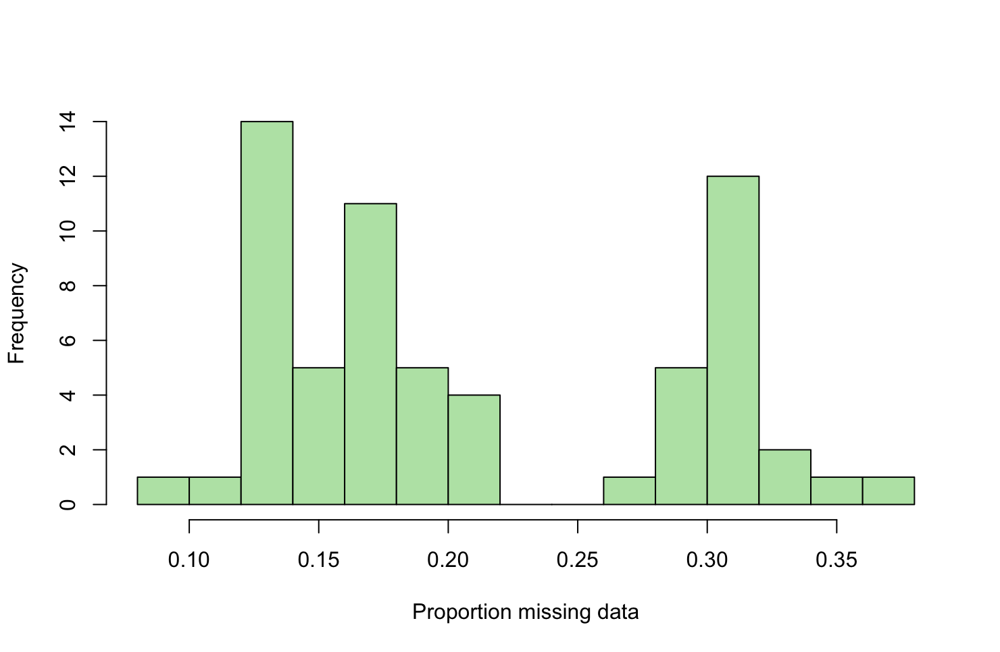

This repository contains step-by-step instructions, code and data for:
Maddie E. James, Jonathan D. Mitchell, Travis Britton, Ben Halliwell, Barbara Holland, Ian Wright, Daniel Ortiz-Barrientos.
Genotypic and phenotypic convergence due to climatic adaptation in *Eucalyptus*.

# Trait analysis
[to complete]

# Genetics analysis

## Bioinformatics

Leaf samples were sent to the Australian Genome Research Facility for DNA extractions and library preparation with the Illumina DNA Prep M Library Prep kit. Samples were pooled in equimolar concentrations and sequenced on two lanes of the NovaSeq 600 S4, 300 cycle with 150bp paired-end sequencing.

### Quality filtering and trimming
For each sample, raw reads were quality-trimmed with ```fastp``` v0.23.4, using: minimum base quality 10, maximum uncalled bases 50, and minimum read length 50 bp. An HTML report was generated for each sample.

```
fastp --in1 forward.fastq.gz --in2 reverse.fastq.gz \
--out1 trimmed_R1.fastq.gz --out2 trimmed_R2.fastq.gz \
-q 10 -u 50 -l 50 -w 1 -h sample_fastp.html
```

### Read alignment
Reads were mapped to the *Eucalyptus grandis* v2.0 reference genome (https://phytozome-next.jgi.doe.gov/info/Egrandis_v2_0) using ```BWA-MEM``` v0.7.19. Read groups were added during mapping. The SAM output was piped into ```SAMtools``` v1.19 for coordinate sorting and BAM creation.

```
bwa mem -t 12 -M -R "@RG\tSM:sample\tID:sampleID\tLB:lib1\tPL:ILLUMINA\tPU:barcode" reference.fasta \
trimmed_R1.fastq.gz trimmed_R2.fastq.gz | \
samtools sort -@ 12 -o sample_srt.bam
```

### Alignment statistics
Alignment statistics were generated with ```SAMtools``` v1.19.

```
samtools flagstat sample_srt.bam > sample_srt_stats.txt
```

### Cleaning BAM files
```Picard``` v3.1.1 CleanSam was used to clean each BAM (to set soft-clipping for reads beyond end of the reference, and MAPQ to 0 for unmapped reads).

```
java -Xmx8g -jar picard.jar CleanSam \
INPUT=sample_srt.bam \
OUTPUT=sample_cln.bam
```

### PCR duplicate marking and indexing
PCR duplicates were marked with ```Picard``` MarkDuplicates. The resulting BAM files were indexed with ```SAMtools```, and per-sample coverage was calculated with SAMtools coverage.

```
java -Xmx4g -jar picard.jar MarkDuplicates \
INPUT=sample_cln.bam \
OUTPUT=sample_PCRm_cln.bam \
METRICS_FILE=sample_PCRm_cln_metrics

samtools index sample_PCRm_cln.bam

samtools coverage sample_PCRm_cln.bam --output sample_coverage.txt
```

### Variant calling
Per-sample variant discovery was performed with ```GATK``` v4.4.0.0 HaplotypeCaller in GVCF mode, retaining both variant and invariant sites. The example below shows one chromosome. Scripts were run in parallel across chromosomes and samples.

```
gatk --java-options "-Xmx8g" HaplotypeCaller \
--input sample_PCRm_cln.bam \
--output sample_Chr01_vrnt.g.vcf.gz \
--reference reference.fasta \
--emit-ref-confidence GVCF \
--intervals Chr01
```

Chromosome-level GVCFs for each sample were concatenated and indexed with ```bcftools```.

```
bcftools concat --threads 6 \
sample_Chr01_vrnt.g.vcf.gz \
sample_Chrn_vrnt.g.vcf.gz \
-o sample_vrnt.g.vcf.gz
bcftools index --threads 6 -t sample_vrnt.g.vcf.gz
```

Individuals were combined into cohorts (i.e. one file per species) with ```GATK``` CombineGVCFs.

```
gatk CombineGVCFs \
-R reference.fasta \
--variant sample01_vrnt.g.vcf.gz \
--variant samplen_vrnt.g.vcf.gz \
-O species1.g.vcf.gz
```

### Joint genotyping 
For each species, joint genotyping was performed per chromosome with ```GATK``` GenotypeGVCFs, retaining variant and invariant sites. The example below shows one chromosome. Scripts were run in parallel across chromosomes and samples.

```
gatk --java-options "-Xmx8g" GenotypeGVCFs \
-R reference.fasta \
-V species1.g.vcf.gz \
-O species1_Chr01_ species1.g.vcf.gz \
--include-non-variant-sites \
--intervals Chr01
```

Chromosome-level cohort VCFs were concatenated and indexed with ```bcftools```.

```
bcftools concat --threads 6 \
species1_Chr01_ species1.g.vcf.gz \
species1_Chrn_ species1.g.vcf.gz \
-o species1_allchrom.g.vcf.gz
bcftools index --threads 6 -t species1_allchrom.g.vcf.gz
```

All populations were merged with ```bcftools``` into a single file, then bgzip-indexed.

```
bcftools merge --threads 96 \
--file-list bcftoolsmerge.txt \
--output allPops.g.vcf.gz
bcftools index --threads 96 -t allPops.g.vcf.gz
```

Missing genotypes encoded as reference with DP=0 were corrected using ```bcftools``` +setGT. This was because GATK v4.4.0.0 encodes missing genotypes as 0/0 with a DP=0 in the format field for single-sample SNP calling with HaplotypeCaller, which can cause downstream issues. The corrected VCF was bgzip-compressed and indexed with ```bcftools```.

```
bcftools +setGT allPops.g.vcf.gz -- -t q -n . -e 'FMT/DP=0' > allPops-Cor.g.vcf
bcftools view allPops-Cor.g.vcf -Oz -o allPops-Cor.g.vcf.gz
bcftools index -t allPops-Cor.g.vcf.gz
```

### SNP filtering
Site-level hard filters were applied with ```GATK``` VariantFiltration.

```
gatk VariantFiltration \
-V allPops-Cor.g.vcf.gz \
-filter "QD < 2.0" --filter-name "QD2" \
-filter "SOR > 3.0" --filter-name "SOR3" \
-filter "FS > 60.0" --filter-name "FS60" \
-filter "MQ < 30.0" --filter-name "MQ30" \
-filter "MQRankSum < -12.5" --filter-name "MQRankSum-12.5" \
-filter "ReadPosRankSum < -8.0" --filter-name "ReadPosRankSum-8" \
-O allPops-CorVFnoQual.g.vcf.gz
```

Using ```VCFtools``` v0.1.17, sites failing GATK filters were removed, and variants were retained if genotyped in at least 50% of individuals.

```
vcftools --gzvcf allPops-CorVFnoQual.g.vcf.gz \
--max-missing 0.5 \
--remove-filtered-all \
--recode --recode-INFO-all --stdout | gzip -c > allPops-CorVFnoQualMM.g.vcf.gz
```

Minimum depth per sample of 3 reads was applied; genotypes with fewer than 3 reads were recoded as missing.

```
vcftools --gzvcf allPops-CorVFnoQualMM.g.vcf.gz \
--minDP 3 \
--recode --recode-INFO-all --stdout | gzip -c > allPops-CorVFnoQualMMdp3.g.vcf.gz
```

To identify low-quality individuals (high missingness), per-individual missing data proportions were computed. The output file (out.imiss) has the fifth column as the proportion missing.

```
vcftools --gzvcf allPops-CorVFnoQualMMdp3.g.vcf.gz \
--missing-indv \
--out allPops-CorVFnoQualMMdp3MissingInds
```



As all individuals contained less than 40% missing data, they were all retained.

Mean depth per site was calculated.

```
vcftools --gzvcf allPops-CorVFnoQualMMdp3.g.vcf.gz \
--site-mean-depth \
--out allPops-CorVFnoQualMMdp3MeanDepth.txt
```

[IMAGE!!!]


Sites were retained if mean depth was between 10 and 100, and only biallelic sites were kept.

```
vcftools --gzvcf allPops-CorVFnoQualMMdp3.g.vcf.gz \
--max-meanDP 100 \
--min-meanDP 10 \
--max-alleles 2 \
--recode --recode-INFO-all \
--out allPops-CorVFnoQualMMdp3MaxMD100MinMD10biallele.g.vcf.gz
```

To ensure representation across populations, we created a 'keep' list, where individuals were grouped by species using a two-column file (individual_name, species_id). The proportion of missing data per site was computed for each species (produces *.lmiss files; column 6 is proportion missing). 

```
vcftools --vcf allPops-CorVFnoQualMMdp3MaxMD100MinMD10biallele.g.vcf.gz.recode.vcf --keep dealba_keep   --missing-site --out dealba
vcftools --vcf allPops-CorVFnoQualMMdp3MaxMD100MinMD10biallele.g.vcf.gz.recode.vcf --keep largiflo_keep --missing-site --out largiflo
vcftools --vcf allPops-CorVFnoQualMMdp3MaxMD100MinMD10biallele.g.vcf.gz.recode.vcf --keep moluc_keep    --missing-site --out moluc
vcftools --vcf allPops-CorVFnoQualMMdp3MaxMD100MinMD10biallele.g.vcf.gz.recode.vcf --keep nitida_keep   --missing-site --out nitida
vcftools --vcf allPops-CorVFnoQualMMdp3MaxMD100MinMD10biallele.g.vcf.gz.recode.vcf --keep regnans_keep  --missing-site --out regnans
vcftools --vcf allPops-CorVFnoQualMMdp3MaxMD100MinMD10biallele.g.vcf.gz.recode.vcf --keep siderox_keep  --missing-site --out siderox
vcftools --vcf allPops-CorVFnoQualMMdp3MaxMD100MinMD10biallele.g.vcf.gz.recode.vcf --keep stricta_keep  --missing-site --out stricta
vcftools --vcf allPops-CorVFnoQualMMdp3MaxMD100MinMD10biallele.g.vcf.gz.recode.vcf --keep vicina_keep   --missing-site --out vicina
vcftools --vcf allPops-CorVFnoQualMMdp3MaxMD100MinMD10biallele.g.vcf.gz.recode.vcf --keep viridis_keep  --missing-site --out viridis
```

A bad loci list was built per species (>70% missing in any species), keeping CHR and POS columns. 

```
cat dealba.lmiss largiflo.lmiss moluc.lmiss nitida.lmiss regnans.lmiss siderox.lmiss stricta.lmiss vicina.lmiss viridis.lmiss \
| awk 'NR>1 && $6 > 0.7 {print $1"\t"$2}' > badloci0.7
```

These positions were excluded from the VCFfile.

```
vcftools --vcf allPops-CorVFnoQualMMdp3MaxMD100MinMD10biallele.g.vcf.gz.recode.vcf \
--exclude-positions badloci0.7 \
--recode --recode-INFO-all \
--out allPops-CorVFnoQualMMdp3MaxMD100MinMD10bialleleMpp70
```

Sites were removed with >20% overall missing data.

```
vcftools --vcf allPops-CorVFnoQualMMdp3MaxMD100MinMD10bialleleMpp70.recode.vcf \
--max-missing 0.8 \
--recode --recode-INFO-all \
--out allPops-CorVFnoQualMMdp3MaxMD100MinMD10bialleleMpp70MM80
```

Indels were removed.

```
vcftools --vcf allPops-CorVFnoQualMMdp3MaxMD100MinMD10bialleleMpp70MM80.recode.vcf \
--remove-indels \
--recode --recode-INFO-all \
--out allPops-CorVFnoQualMMdp3MaxMD100MinMD10bialleleMpp70MM80noIndelsVCFtools
```

Final dataset (allPops.vcf): 160,686,818 variant and invariant sites; 12,608,766 variant sites with MAF ≥ 0.05. As the final dataset is quite large, it is available upon request. 

## Convergence divergence models
[to complete]

## Population genetics analyses

We calculated population genetics statistics to examine signatures of selection along the genome. This was undertaken for the three species pairs with 10 individuals per species: the two wet-dry contrasts of *E. moluccana*–*E. largiflorens* and *E. dealbata*–*E. vicina*, and the wet-wetter contrast of *E. nitida*–*E. regnans*. FST, dXY and π were calculated with 20kB non-overlapping sliding windows in ```pixy``` v1.2.10, which accounts for monomorphic sites when calculating diversity and divergence statistics. 

```
pixy --stats pi fst dxy \
--vcf allPops.vcf.gz \
--populations allPops_popfile.txt \
--output_prefix 20000 \
--window_size 20000 \
--n_cores 6 \
```

Tajima’s D was calculated for each population in VCFtools using 20kB non-overlapping sliding windows. 

```
vcftools --vcf allPops.vcf --keep dealba.txt --TajimaD 20000 --out dealba_tajimasD_20000
vcftools --vcf allPops.vcf --keep largiflo.txt --TajimaD 20000 --out largiflo_tajimasD_20000
vcftools --vcf allPops.vcf --keep moluc.txt --TajimaD 20000 --out moluc_tajimasD_20000
vcftools --vcf allPops.vcf --keep nitida.txt --TajimaD 20000 --out nitida_tajimasD_20000
vcftools --vcf allPops.vcf --keep regnans.txt --TajimaD 20000 --out regnans_tajimasD_20000
vcftools --vcf allPops.vcf --keep vicina.txt --TajimaD 20000 --out vicina_tajimasD_20000
```

We used custom R code [CombiningFiles-allThreePairs.R](Population%genetics%20analyses/CombiningFiles-allThreePairs.R) to combine the above population genetics statistics into a single file per population pair. 

Files are as follows: 
*E. moluccana*–*E. largiflorens*: [moluc_largiflo_merged.csv](Population%genetics%20analyses/moluc_largiflo_merged.csv)
*E. dealbata*–*E. vicina*: [dealba_vicina_merged.csv](Population%genetics%20analyses/dealba_vicina_merged.csv)
*E. nitida*–*E. regnans*: [nitida_regnans_merged.csv](Population%genetics%20analyses/nitida_regnans_merged.csv)


[R code for plotting and summaries etc]


[to finish]

## Genotype-Environment Association (GEA) analysis

We undertook Genotype-Environment Association (GEA) analysis in ```BayPass``` v3.0. 

The VCF file (allPops.vcf) was filtered for a MAF ≥ 0.01.

```
vcftools --vcf allPops.vcf --recode --recode-INFO-all --maf 0.01 --out allPopsMAF0.01
```

SNPs in LD were removed in ```PLINK``` v1.9 with the following parameters: a window size of 50 SNPs, step size of 5 SNPs and r2 threshold of 0.2, leaving 4,202,577 SNPs across the 11 chromosomes.

```
plink --vcf allPopsMAF0.01.recode.vcf --indep-pairwise 50 5 0.2 --allow-extra-chr --set-missing-var-ids @:# --out allPopsMAF0.01_LD-50-5-0.2
plink --vcf allPopsMAF0.01.recode.vcf --extract allPopsMAF0.01_LD-50-5-0.2.prune.in --recode vcf --set-missing-var-ids @:# --allow-extra-chr --out allPopsMAF0.01_LD-50-5-0.2
```

As the ```BayPass``` core model requires a set of neutral SNPs, global FST was calculated among all species.

```
vcftools --vcf allPopsMAF0.01_LD-50-5-0.2.vcf \
         --weir-fst-pop dealba.txt \
         --weir-fst-pop largiflo.txt \
         --weir-fst-pop moluc.txt \
         --weir-fst-pop nitida.txt \
         --weir-fst-pop regnans.txt \
         --weir-fst-pop siderox.txt \
         --weir-fst-pop stricta.txt \
         --weir-fst-pop vicina.txt \
         --weir-fst-pop viridis.txt \
         --out globalFst_allPopsMAF0.01_LD-50-5-0.2
```

We retained only the chromosome SNPs (Chr01–Chr11) and determine the 90th-percentile FST cutoff (~0.57 in our dataset). 

```
plink --vcf MAF0.01_LD-50-5-0.2.vcf \
      --chr 1-11 \
      --allow-extra-chr --set-missing-var-ids @:# \
      --exclude top10pct_Fst_positions.txt \
      --recode vcf \
      --out allPopsMAF0.01_LD-50-5-0.5_chr1-11_top10FstRemoved
```

Next, allele counts were obtained per species. Note the ---keep-allele-order keeps consistent ref/alt alleles across the files (column A1 is ref, column A2 is alt). 

```
for pop in dealba largiflo moluc nitida regnans siderox stricta vicina viridis; do
    ./plink --vcf allPopsMAF0.01_LD-50-5-0.2_chr1-11_top10FstRemoved.vcf --allow-extra-chr --keep-allele-order --keep ${pop}_samples_plink_fixed.txt --freq --out ${pop}_allelefreq_LD-50-5-0.2_chr1-11_top10FstRemoved
done
```

We used a custom script ([convert_to_baypass.sh](Genotype-Environment%20Association%20analysis/convert_to_baypass.sh)) to convert the VCF file (with the top 10% of global FST outliers removed) into BayPass format of allele counts. The input file can be found here: [baypass_allele_counts_MAF0.01_LD-50-5-0.2_chr1-11_top10FstRemoved.txt.zip](Genotype-Environment%20Association%20analysis/baypass_allele_counts_MAF0.01_LD-50-5-0.2_chr1-11_top10FstRemoved.txt.zip). 

The ```BayPass``` core model was run with three independent replicates (each with a different seed) with the set of neutral SNPs to produce the covariance matrix. 

```
g_baypass -countdatafile baypass_allele_counts_MAF0.01_LD-50-5-0.2_chr1-11_top10FstRemoved.txt -outprefix CoreModel_MAF0.01-LD-50-5-0.2_chr1-11_top10FstRemoved_rep1 -seed 12345
g_baypass -countdatafile baypass_allele_counts_MAF0.01_LD-50-5-0.2_chr1-11_top10FstRemoved.txt -outprefix CoreModel_MAF0.01-LD-50-5-0.2_chr1-11_top10FstRemoved_rep2 -seed 67890
g_baypass -countdatafile baypass_allele_counts_MAF0.01_LD-50-5-0.2_chr1-11_top10FstRemoved.txt -outprefix CoreModel_MAF0.01-LD-50-5-0.2_chr1-11_top10FstRemoved_rep3 -seed 13579
```

The median of the mat_omega.out ouput file was caluclated across the three replicates to generate the input covariance matrix for the standard model. The file can be found here: [BayPass_CoreModel_MAF0.01-LD-50-5-0.2_chr1-11_top10FstRemoved_median_mat_omega.out](Genotype-Environment%20Association%20analysis/BayPass_CoreModel_MAF0.01-LD-50-5-0.2_chr1-11_top10FstRemoved_median_mat_omega.out). The above convert_to_baypass.sh script was used to convert the VCF file (without the top 10% FST outliers removed) into the BayPass format of allele counts. File: [baypass_allele_counts_MAF0.01_LD-50-5-0.2_chr1-11.txt.zip](Genotype-Environment%20Association%20analysis/baypass_allele_counts_MAF0.01_LD-50-5-0.2_chr1-11.txt.zip) The ```BayPass``` standard model was run with three independent replicates (each with a different seed). Mean annual precipitation per species was used as a covariate. The file can be found here: [MeanAnnualPrecipitation_Covariate.txt](Genotype-Environment%20Association%20analysis/MeanAnnualPrecipitation_Covariate.txt). 


```
g_baypass -countdatafile baypass_allele_counts_MAF0.01_LD-50-5-0.2_chr1-11.txt -efile MeanAnnualPrecipitation_Covariate.txt -omegafile BayPass_CoreModel_MAF0.01-LD-50-5-0.2_chr1-11_top10FstRemoved_median_mat_omega.out -outprefix BayPass_StandardModel_MAF0.01-LD-50-5-0.2_chr1-11_rep1 -seed 12345 -nthreads 8
g_baypass -countdatafile baypass_allele_counts_MAF0.01_LD-50-5-0.2_chr1-11.txt -efile MeanAnnualPrecipitation_Covariate.txt -omegafile BayPass_CoreModel_MAF0.01-LD-50-5-0.2_chr1-11_top10FstRemoved_median_mat_omega.out -outprefix BayPass_StandardModel_MAF0.01-LD-50-5-0.2_chr1-11_rep2 -seed 67890 -nthreads 8
g_baypass -countdatafile baypass_allele_counts_MAF0.01_LD-50-5-0.2_chr1-11.txt -efile MeanAnnualPrecipitation_Covariate.txt -omegafile BayPass_CoreModel_MAF0.01-LD-50-5-0.2_chr1-11_top10FstRemoved_median_mat_omega.out -outprefix BayPass_StandardModel_MAF0.01-LD-50-5-0.2_chr1-11_rep3 -seed 13579 -nthreads 8

```

The median of the three replicate ouput files was caluclated: [repMedian_summary_betai_reg.out](Genotype-Environment%20Association%20analysis/repMedian_summary_betai_reg.out). The results were summarised and plotted in R. See [Plotting_and_GenicIntergenic.R](Genotype-Environment%20Association%20analysis/Plotting_and_GenicIntergenic.R), lines 1-150 for code and details. See lines 153-210 for the code for plotting the bayes factors (BF) vs the effect size per SNP. 

We mapped the outlier SNPs to the corresponding *Eucalyptus* genes and *Arabidopsis* orthologues based on the information in the annotated *E. grandis* reference genome. see lines 213-501 of the above R code for details and various summary plots. 

